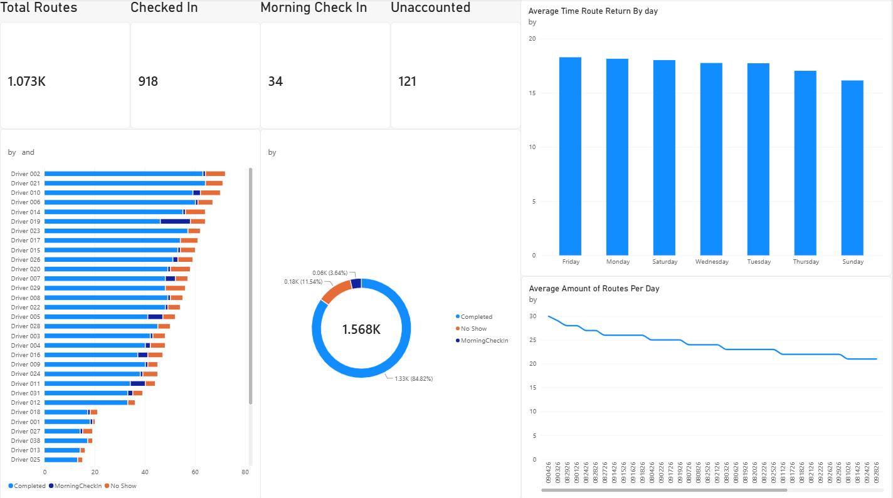

# Home Delivery Route Check-In Tracker

An end-to-end data project that tracks daily delivery-route check-ins: a raw log is cleaned with **Python**, analyzed with **SQL**, stored in **Access/Excel**, and presented in a **Power BI** dashboard.

> All driver names and route IDs are anonymized (e.g. `Driver 001`, `Route-00001`). No actual operations data used and no customer data is included.



## The problem I solved
Operations, the trucking companies contracted, and dispatch needs clear information on truck drivers and their routes. They should be able to know what drivers checked in early, which have to check in the next morning, and which routes are unaccounted for. The raw data had been kept in a messy excel file, which was unusable for analysis.

## What's in this?
| Path | What it is |
|---|---|
| `clean_route_data.py` | Python data-cleaning process |
| `sql/dashboard_queries.sql` | Example SQL queries |
| `tests/test_cleaning.py` | tests for the cleaner |
| `data/RandomizedDataExample_trimmed.xlsx` | Anonymized sample input (1,568 rows) |
| `output/` | Cleaned CSV, cleaning report, SQLite database |
| `screenshots/` | Power BI dashboard |

## Quick start
```bash
pip install -r requirements.txt
python clean_route_data.py data/RandomizedDataExample_trimmed.xlsx --sqlite
python -m pytest tests/
sqlite3 output/routes.db < sql/dashboard_queries.sql   # or open routes.db in DB Browser for SQLite
```

## What the cleaner fixes
| Problem found in the raw data | Fix |
|---|---|
| ~1,047,000 empty "phantom" rows in the Excel sheet | Dropped; real rows kept |
| Dates stored as numbers with the leading zero lost (`80326`) | Zero restored, parsed as MMDDYY, output as ISO `2026-08-03` |
| `00:00:00` used as a "no data" placeholder in check in time (188 rows) | Converted to blank so averages are not skewed |
| `MorningCheckIn` mixed True/False, Excel time fractions, text like `6:05pm`, and junk | Split into `MorningCheckInFlag` and `MorningCheckInTime`; junk flagged |
| Missing route IDs (495 rows) | **Flagged** |
| Status vs CheckedIn contradictions, duplicates, weekday vs date check | Validated and flagged |
| Whole days with missing or implausible data | Reported (see findings) |

Every row carries a `DataQualityNotes` column, and every run writes `cleaning_report.txt`, so the cleaning is auditable.

## Verification
The cleaner's output reconciles with the dashboard: **1,073 routes / 918 checked in / 34 morning check-ins / 121 unaccounted**.

## Findings
- **119 of the 121 "Unaccounted" no-shows fall in Sep 1-6, and there is no data for Sep 7-13.** Check-in tracking gap rather than real missing drivers, so the Unaccounted KPI likely overstates the problem. Confirm before reporting it.
- **495 rows (Sep 30 - Oct 25) have no RouteID**, so they are excluded from the dashboard KPIs but present in some visuals. Total counts differ between visuals (1,073 vs 1,568) for this reason.

## Assumptions
- A recorded morning check-in time implies the driver checked in the next morning.
- Midnight arrival times are placeholders, not real returns.

## Tools
Python (pandas), SQL (SQLite syntax; written to port to T-SQL), Microsoft Access, Excel (Excel Query as well), Power BI.
